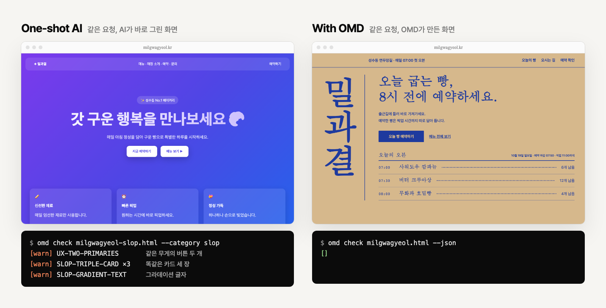
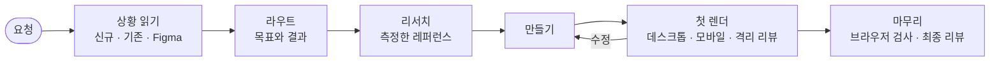

<p align="center">
  <picture>
    <source media="(prefers-color-scheme: dark)" srcset="brand/readme/header-dark.svg">
    
  </picture>
</p>

<h3 align="center">사람처럼 디자인하는 AI.</h3>

<p align="center">
코딩 에이전트를 위한 오픈소스 디자인 하네스입니다. OMD는 그리기 전에 누구를 위한 화면인지 묻고,<br>
실제 레퍼런스를 찾아 재고, 한 번 만든 뒤, 렌더한 결과를 사람이 만든 페이지와 블라인드로 비교해 AI 티를 검사합니다.
</p>

<p align="center">
  <a href="https://www.npmjs.com/package/@3xhaust/oh-my-design"></a>
  <a href="https://www.npmjs.com/package/@3xhaust/oh-my-design"></a>
  <a href="https://github.com/3x-haust/oh-my-design/actions/workflows/ci.yml"></a>
  <a href="https://github.com/3x-haust/oh-my-design/stargazers"></a>
  <a href="LICENSE"></a>
</p>

<p align="center">
  <b>Claude Code</b> · <b>Codex</b> · <b>Pi</b>
  &nbsp;—&nbsp;
  <a href="#빠른-시작">빠른 시작</a> · <a href="#동작-방식">동작 방식</a> · <a href="https://3x-haust.github.io/oh-my-design/">랜딩 페이지</a> · <a href="README.md">English</a>
</p>

https://github.com/user-attachments/assets/f19a0543-e66c-4be5-bb28-20e0f42aced9

<p align="center"><sub>OMD 소개 영상(39초, 소리 있음): AI가 한 번에 만든 페이지를 넣으면, 같은 페이지가 결정 하나씩 다시 디자인되어 나옵니다.</sub></p>

## 같은 요청, 다른 과정

<p align="center"></p>

같은 빵집 예약 페이지 요청입니다. 왼쪽은 모델이 한 번에 그린 화면, 오른쪽은 OMD가 디자인한 화면입니다.
아래는 각 페이지에 실제로 돌린 `omd check` 출력입니다. 왼쪽은 슬롭 규칙(같은 무게의 버튼 두 개, 똑같은 카드 세 장,
그라데이션 글자)에 걸리고, 오른쪽은 경고가 없습니다. 두 페이지는 소개 영상에 쓴 예시 페이지이며,
슬롭 경고는 품질의 바닥선일 뿐 AI가 만들었다는 증거는 아닙니다.

## 빠른 시작

```bash
npm install -g @3xhaust/oh-my-design
oh-my-design install    # 감지된 모든 호스트에 스킬과 리뷰어 에이전트를 설치
omd doctor              # 런타임, Chromium, 쓰기 권한, theory pack 확인
```

그다음 에이전트에게 디자인을 요청하세요.

| 호스트 | 예시 |
| --- | --- |
| Claude Code | `/ultradesign 성수동 빵집 예약 페이지 만들어줘` |
| Codex | `$omd-ultradesign 성수동 빵집 예약 페이지 만들어줘` |
| Pi | `pi install npm:@3xhaust/oh-my-design` 후 `/ultradesign 성수동 빵집 예약 페이지 만들어줘` (`/omd`는 프로젝트 점검) |

Node.js 22.19 이상이 필요합니다. 모든 설치 방법, Claude Code 마켓플레이스, 브라우저 공급자는 [설치](#설치)에 있습니다.

## 원샷 프롬프트가 건너뛰는 네 가지 습관

| 먼저 묻기 | 무드보드 대신 측정 | 블라인드로 리뷰 | 스스로 검사하기 |
| --- | --- | --- | --- |
| 레이아웃 전에 목표, 있어야 할 결과와 없어야 할 결과, 과업 계약을 기록합니다. | 타입·밀도·구성을 잰 레퍼런스를 모으고, 픽셀이 아니라 원리를 옮깁니다. | 페이지를 만들지 않은 격리된 리뷰어가 만든 사람의 설명 없이 캡처를 판단합니다. | `omd first-render check`로 데스크톱·모바일을 렌더하고, 리뷰가 찾은 문제를 고친 뒤 `omd lifecycle finish`로 마무리합니다. |

## 동작 방식



정해진 체크리스트가 아니라 적응형 경로입니다. 요청에 필요한 방법은 모델이 고르며, 쓰지 않은 방법에 건너뛴 이유를 따로 적지 않습니다.
전체 흐름은 [휴먼 디자인 루프](#휴먼-디자인-루프)에 있습니다.

## 스킬

사용자용 스킬은 `omd-ultradesign` 하나이며, 유일한 진입점입니다. Codex는 `(omd) ultradesign`으로 표시하고, Claude 마켓플레이스 플레이버는 `oh-my-design:ultradesign`으로 참조합니다. 프로젝트와 요청 전체를 스스로 읽고, 어떤 모드로 할지 사용자에게 묻지 않습니다.

| 상황 | `omd-ultradesign`이 하는 일 |
| --- | --- |
| 아직 제품 소스가 없음 | 요청한 제품 전체를 처음부터 만듭니다. 방향을 정하기 전에 좋은 레퍼런스를 먼저 살핍니다. |
| 기존 프로젝트 | 스택, 라우트, 컴포넌트, 토큰, 현재 렌더를 먼저 읽습니다. 새 기능은 기존 시스템을 확장하고, 리디자인은 현재 데스크톱·모바일 화면을 기준선으로 캡처한 뒤 모든 기능·라우트·데이터 계약을 유지하며, 수정은 해당 부분에만 머뭅니다. |
| 요청에 Figma 링크 | 프레임을 목표로 삼고, 격리된 리뷰어가 `match`를 돌려줄 때까지 `omd figma diff`와 `omd figma review`를 반복합니다. |
| 사용자가 준 이미지·URL | 사용자가 정한 역할을 유지합니다. 구현 목표, 영감, 도메인 근거, 또는 비교 기준선으로만 쓰는 거절된 결과입니다. |

레퍼런스, Figma, 카피, 비평, 감사, 코칭 지침은 필요할 때만 스킬이 여는 내부 가이드(`omd pack guides/<name>.md`)로 제공됩니다.

## OMD로 만든 결과 — 원샷 프롬프트

OMD가 단일 원샷 프롬프트로 생성한 랜딩 페이지입니다 — 시각 출력은 손으로 다듬지 않았습니다. **[3x-haust.github.io/oh-my-design](https://3x-haust.github.io/oh-my-design/)** 에서 볼 수 있습니다.

## 문서

<details>
<summary><b>‘사람처럼 디자인한다’의 뜻</b></summary>

### OMD란

**사람처럼 디자인하는 AI.** 요청을 한 번 입력하면 OMD가 실제 자료를 조사·비교하고 방향을 선택한 뒤 제작·렌더·수정을 내부에서 이어갑니다. 관찰한 근거에 따라 방법을 조정하며, 일상적인 레퍼런스·시안 승인을 요구하지 않습니다. 계정 접근과 외부 변경 권한은 별도로 유지합니다.
네이티브 Pi의 일반 자율 실행과 명시적으로 켠 비공개 개발자 평가는 같은 제작 엔진을 사용합니다. [실행 방법·비공개 평가·버전별 보정 안내](core/protocol/autonomous-design.md)를 참고하세요. 기술적 연결은 테스트했지만 사람 수준 품질 주장은 실제 블라인드 평가가 필요합니다.

여기서 ‘사람처럼 디자인한다’는 것은 특정한 결과 스타일이 아니라 근거를 남기는 판단을 뜻합니다. 목표는 반복 가능한 프로세스이며, 결과는 차분할 수도 과감할 수도 익숙하거나 낯설 수도 있습니다. 일관되는 것은 결과의 생김새가 아니라 그 뒤에 남은 결정의 흐름입니다.

[디자인 실행 계약](core/protocol/design-practice.md)이 선택된 작업 안에서 이 기준을 구체화합니다.
동작 검증과 사람 수준의 품질 주장은 구분합니다.
루트 `/docs/`의 조사·개발 메모는 로컬에 보관하며 저장소에서 추적하거나 공개하지 않습니다.

콘셉트 탐색은 내용에서 출발합니다. 하나의 강한 아이디어로 화면 전체를 구성할 수 있고,
서로 다른 안이 같은 브랜드 색을 사용할 수도 있습니다. 최종 페이지를 HTML과 CSS로 만들더라도
시각 초안은 방향을 고르는 데 쓸 수 있습니다. 구현 가능한 안들의 실제 디자인과 과업 적합성을
비교하며, 빌드나 초안 충실도 검사를 통과했다는 사실만으로 시각적 완성도를 판단하지 않습니다.

Oh My Design(OMD)은 코딩 에이전트가 요청을 받자마자 완성 화면으로 뛰어드는 흐름을 막습니다. 어떤 문제를 푸는지 먼저 묻고, 근거를 기록하고, 실제 레퍼런스를 비교하고, 구현자의 의도를 모르는 격리된 리뷰어가 실제 렌더를 비평합니다.

전체 흐름은 모든 단계를 강제하는 체크리스트가 아니라 적응형입니다.

```text
original request → route (outcome, scope, evidence) → references and model-chosen methods
                 → production build → first render: isolated desktop/mobile review → repair
                 → lifecycle finish: package checks, real browser captures, independent review
```

제품 작업과 마케팅 작업은 다르게 조사합니다. 제품 UI는 실제 서비스의 데이터가 채워진 과업
화면과, 랜딩·출시 페이지는 완성된 서비스 웹사이트와 비교합니다. 두 경우 모두 사용자가 고른
모델을 유지하며, 정보가 부족한 그린필드 컨셉을 차별적으로 보이게 하려고 제품 기능을 창작하지
않습니다.

OMD는 **Codex**, **Claude Code**, 그리고 공개 **Pi extension API**를 구현한 호스트에서 동작합니다. 사용자용 스킬 하나(`omd-ultradesign`), 읽기 전용 리뷰어 에이전트 하나(`omd-eye`), 로컬 `omd` CLI, 디자인 이론·레시피 팩, 그리고 `.omd/` 아래의 내구 프로젝트 기록을 제공합니다.

</details>

<details>
<summary><b>요구 사항</b></summary>

### 요구 사항

- **Node.js 22.19 이상** (CLI가 TypeScript 진입점을 직접 실행합니다)
- **Claude Code, Codex, 또는 Pi 호환 호스트**
- 브라우저 공급자: 두 지원 플랫폼에서는 **browser-rs v0.1.10**을 우선 사용하고, 렌더·프로브·타이포그래피 증명을 위해 **Playwright + Chromium** 폴백을 유지합니다(아래 참고).

</details>

<details>
<summary><b>설치 — 모든 방법, Pi, 브라우저 공급자, 레퍼런스 리서치</b></summary>

### 설치

#### npm — 전역 CLI (권장)

```bash
npm install -g @3xhaust/oh-my-design
oh-my-design install    # 감지된 모든 호스트에 플러그인을 설치하고 설정을 패치
oh-my-design doctor     # 호스트 설치 검증
omd doctor              # 런타임, Chromium, 프로젝트 쓰기 권한, 이론 팩 검증
```

`oh-my-design install --host claude|codex` 로 install·doctor·uninstall 을 한 호스트로 한정할 수 있습니다. `uninstall` 은 `install` 이 한 일을 정확히 되돌리며, `.omd/` 디렉터리는 절대 건드리지 않습니다. 호스트 설치 뒤에는 browser-rs도 시도하고 `present`, `installed`, `unsupported`, `failed`를 보고합니다. browser-rs가 실패해도 정상 OMD/Playwright 호스트 설치를 롤백하지 않습니다.

> 반드시 **스코프** 패키지 `@3xhaust/oh-my-design` 를 설치하세요. 스코프 없는 `oh-my-design` 은 무관한 다른 프로젝트입니다.

#### Pi 호환 호스트 — extension package

OMD는 표준 Pi package입니다. Pi와 Senpi 같은 API 호환 fork는 동일한 extension과 canonical
skill을 로드합니다. OMD가 Senpi 실행 파일을 탐색하거나 별도 프로세스로 실행하지 않습니다.

```bash
pi install npm:@3xhaust/oh-my-design
```

호환 fork에서는 그 호스트의 package 설치 명령에 같은 npm package를 전달합니다. Extension은
프로젝트 doctor 검사용 `/omd`와 기존 OMD CLI를 구조화된 인자로 실행하는 `omd_cli` 도구를
등록합니다. `/ultradesign <요청>`은 `/skill:omd-ultradesign <요청>`의 별칭입니다.
공개 Pi extension/package API만 사용하며 fork 전용 API에는 의존하지 않습니다.

Pi에서 `omd_cli`를 사용할 때 외부 activation 파일은 필요하지 않습니다. 라우트 입력은 먼저
`omd route validate --input .omd/.cache/route-input.json --json`으로 검사하고, 오류에 표시된
필드를 고친 다음 `route classify`로 저장합니다. 입력 오류를 인증 누락으로 처리하지 않습니다.

[3-Layer 실행 계약](core/protocol/three-layer-enforcement.md)은 **규칙 선언 → 절차 → 자동 차단**을 연결합니다.
`route classify` 후 `omd stage next --json`이 현재 모델 주도 작업을 알려 줍니다. 소스 작업 전에는
`omd guard production --json`을 통과해야 하며, 실패한 guard는 앱 소스를 바꾸지 않습니다.
`omd guard completion --json`은 완료 응답을 보류시키는 차단 사유를 보고합니다.
Pi의 공개 `tool_call`/`message_end` 훅은 앱 파일 `write`/`edit`와 임의 `bash`가 현재 설계 입력 검증을
통과해야 실행되도록 합니다. 리서치 입력·직접 소유한 설계 문서 작성은 계속 가능합니다. 최종 검증에 실패하면
검증되지 않은 완료 응답을 보류합니다. OMD 명령은 프로젝트별로 직렬화해 mutation lock 충돌을 줄입니다.
소스 작성을 시도한 턴의 수정 가능한 최종 실패는 작업 포인터나 작성된 증거가 바뀌는 동안 수정·재검사를 계속합니다.
같은 실패 상태가 두 번 연속 반복되면 루프를 멈추며, 권한 부족이나 사용자 중단은 자동 재시도하지 않습니다.
최종 메시지 교체 API는 Pi 0.85.1 기준이며,
fork도 단순한 `on` 함수뿐 아니라 같은 이벤트 반환 동작을 지원해야 합니다.
`/reload` 후 `/omd`로 확인하세요. 이벤트 훅이 없는 호스트는 CLI 검사만 가능하다고 표시합니다.
이는 OS 샌드박스나 미적 품질 보증이 아닙니다. 외부 프로세스·별도 쓰기 도구는 훅의 경계 밖이며,
스트리밍 초안은 최종 검증 전에 보일 수 있습니다. 독립 리뷰 권한을 임의로 만들지도 않습니다.
업데이트로 기존 build/skill 권한이 오래됐다면 원래 승인된 범위로 route validate/classify를 다시 실행해야
합니다.

레퍼런스 조사는 **도메인**(`.omd/refs/domain/research.json`: 유사 서비스의 화면·기능·플로우)과
**디자인**(`.omd/refs/design/research.json`: 구성·타이포·밀도·컴포넌트)으로 따로 저장합니다.
`omd ref add <url> --as <name> --lane domain|design`으로 캡처 PNG와 메타데이터부터 각 폴더에
저장합니다. `ref add-batch`의 각 항목도 `lane`을 지정합니다. `ref list --lane domain|design --json`으로
따로 조회할 수 있으며, 도메인 캡처는 시각 디자인 보드에 자동으로 섞이지 않습니다.
`omd ref discover-plan --json`은 앱/제품 UI에 Mobbin·Page Flows·Pinterest·Dribbble·Behance(선택적으로 UI Bowl 공개 화면), 웹/마케팅에 Siteinspire·Pinterest
같은 탐색 후보를 제시합니다. 실제 무료 열람 가능한 항목만 사용하며, 막힌 출처는 다른 공개
출처로 대체합니다. 유료 결제·체험 시작·MCP 자동 설치는 하지 않습니다. 무료 열람과 재사용
권한은 별개입니다. 갤러리 이름만으로 품질을 인정하지 않고 원본 화면과 선택 이유를 기록합니다.
갤러리 작품은 `omd ref navigate <항목 URL> --lane design --json`으로 방문해 탐색 기록을 `.omd/discovery/design/`에 둡니다. 디자인 근거에는 연결된 원본 화면 또는 `omd ref add <항목 URL> --lane design --selector `로 선택한 실제 UI 이미지 요소만 저장합니다. 이미지 요소는 `omd ref import-image`로 시각 전용 근거로 등록합니다. 자르기는 필수가 아니며 갤러리 바깥 화면은 디자인 폴더에 저장하지 않습니다.
`omd schema reference-research --json` → `omd ref research-set --input <input.json>` →
`omd ref research-check --json`으로 두 파일과 통합 일치 기록을 검증합니다. 갤러리 홈 주소만으로는
통과하지 않습니다. 개별 항목의 PNG·캡처 JSON과 원본 출처를 대조하고, 원본이 다른 페이지라면
갤러리에서 실제 관찰한 링크가 그 출처를 가리켜야 합니다. 검증기는 두 조사의 출처 호스트·최종
리다이렉트·이미지 중복도 거부합니다. 현재 v7 조사는 시장이 명시되면 출처별 시장 근거까지
기록하며 도메인/디자인 레인을 분리합니다. 별도 시장 지정이 없는 한국어 서비스 기획은 레퍼런스 조사에서 한국 서비스를 먼저 찾고 두 레인 모두 현지 근거를 요구합니다. 이 기본값은 국가별 미감을 추론하지 않습니다. 업무 페이지를 갤러리라고 이름 붙이거나 다른 영역을
캡처해 디자인 조사를 대신할 수 없습니다. 유료 UI Bowl MCP 없이 공개 항목으로 진행합니다.
디자인 자료는 `visual-direction`과 `component-support`를 구분하고 구성·타이포·밀도·이미지·
적용할 것·제외할 것을 기록합니다. 현재 v7은 서로 다른 서비스 계열과 갤러리 항목에서 수집한
시각 방향 자료가 2개 이상이어야 하며 PNG 바이트도 달라야 합니다. 두 방향 모두 현재 보드에
실제로 사용해야 하고, 추적 파라미터만 다른 URL·파일명만 바꾼 캡처·쓰지 않은 스크린샷은
개수에 포함하지 않습니다. 모든 보드 후보가 시각 방향 자료를 실제 사용해야 합니다.
미리보기와 선정 이유는 `.omd/refs/design/README.md`에서 확인합니다. 과거 v5는 검색 전용,
v6는 검색 또는 직접 공개 목록 계약으로 계속 읽을 수 있습니다. 유효한 캡처도 현재 검증과
마이그레이션이 허용할 때만 재사용하고, 과거 바이트를 새 기록으로 가장하지 않은 채 v7로 발행합니다.
자동 검증은 미적 품질의 인증이 아닙니다.

현재 v7에서는 검색어만 적어서는 통과하지 않습니다. `omd ref search --input <json>`에
`{lane, query, url, queryParam}`을 주면 새 브라우저의 실제 GET·관찰 링크·캡처·실패를 기록합니다.
반환된 영수증을 각 조사의 `searches`에 넣습니다. 모든 검색어는 실행 기록과 일치해야 하고,
선정한 비사용자 출처/갤러리 항목은 관찰 링크와 별도의 실제 방문 캡처로 이어져야 합니다.
실패 기록은 무료 대체 출처의 성공 기록과 함께 남길 수 있습니다. HTTP 200만으로 품질을 인정하지 않습니다.
검색 실행은 Google/Bing/DuckDuckGo 공개 검색 페이지와 `queryParam: "q"`를 사용합니다. 화면·패턴 키워드에
`site:pinterest.com/pin/` 같은 출처 조건을 조합하며, 업무 페이지에 임의 검색 파라미터를 붙인 것은 거부합니다.
검색이 차단되면 v6/v7은 `omd ref navigate`를 통한 서명된 직접 공개 목록 탐색도 허용합니다.
새 search-v2/direct-entry-v3 기록은 프로젝트 서명으로 변조를 탐지하지만, 제공자 인증이나
디자인 품질·시장 적합성·공식성의 인증서는 아닙니다.
명시된 시장의 로컬 근거로 쓰려면 서명된 검색 결과에서 해당 링크에 붙은 보이는 문구가 시장명과
관련 서비스/제품 범위를 직접 밝혀야 합니다. 검색어만 현지화했다고 로컬 출처가 되지는 않습니다.
이 시장 근거와 선정한 출처의 관찰 기록은 모두 7일 이내여야 합니다.
직접 공개 목록도 선택한 링크의 보이는 라벨에 같은 기준을 적용합니다. 목록의 다른 시장 헤더로
무관한 서비스를 로컬 출처로 만들 수 없습니다. 선언한 모든 시도와 선택한 보관 캡처는 7일 제한을
받고, global fallback 출처도 자신에게 도달한 서명된 검색/직접 탐색 영수증과 링크별로 결합됩니다.

검색 결과에서 관련 핀을 따라간 경우 각 조사 레인의 `navigation`에 중간 페이지의 네이티브 캡처를
넣습니다. 실제 관찰한 링크로 연결된 경로만 인정하며, 같은 사이트의 다른 페이지도 서로 다른 파일로 저장합니다.

첫 렌더 검사 `omd first-render check --page <local-build.html>`는 미리보기 URL이 아니라 로컬 프로덕션
빌드를 캡처하며, 에이전트가 작성한 화면 입력은 거부합니다. 단순 권고만으로 완료를 막지 않습니다.

#### Claude Code — 플러그인 마켓플레이스

```text
/plugin marketplace add 3x-haust/oh-my-design
/plugin install oh-my-design@omd
```

이후 세션을 열고 `/ultradesign` 을 실행합니다.

#### 소스에서 설치 (기여자)

```bash
git clone https://github.com/3x-haust/oh-my-design
cd oh-my-design
npm install
node bin/omd-install.ts install    # 감지된 호스트에 플러그인 설치
node bin/omd.ts doctor

# 전역 설치 없이 Pi에서 source extension을 시험합니다.
pi -e ./extensions/omd.ts
```

#### 브라우저 공급자와 Chromium (전역 설치 후)

전역으로 `@3xhaust/oh-my-design`을 설치한 뒤 OMD는 대화형 레퍼런스 조사, 사용자가 지정한 영역 캡처, 시각 QA에서 `browser-rs` MCP 공급자를 우선합니다. 이는 의도적으로 범위를 좁힌 v0.1.10 통합이며, 모든 브라우저/사이트 호환성을 주장하지 않습니다.

| 플랫폼 | browser-rs 상태 | 정확한 SHA-256 |
| --- | --- | --- |
| Darwin arm64 | 지원됨. healthy일 때 기본 대화형 공급자 | `9a5895fc2f07b1010226d30f081d678fa2edcc15dd6f24cdf10074cfe1573749` |
| Linux x64 | 지원됨. healthy일 때 기본 대화형 공급자 | `792ca76e5ce0423968763556e110900a3aa65737fc6227724914aa137e972589` |
| 그 외 모든 플랫폼 | 지원하지 않으며 browser-rs를 내려받지 않음 | 아래 Playwright + Chromium 폴백을 사용합니다. |

설치된 OMD 관리 바이너리는 `receipt.json`과 함께 `$HOME/.local/share/oh-my-design/browser-rs/v0.1.10/browser-rs`에 놓입니다. OMD는 게시 전에 정확한 체크섬을 검증합니다. 탐색 순서는 `OMD_BROWSER_RS_BIN`, `PATH`의 `browser-rs`, 그 다음 receipt로 소유권이 확인된 이 관리 대상입니다. OMD는 외부 override/PATH 바이너리나 영수증이 없거나 변조된 관리 대상 파일을 덮어쓰지 않으며, `oh-my-design browser uninstall`은 OMD 소유이고 receipt·digest가 모두 맞는 바이트만 지웁니다.

```bash
# 명시적 공급자 수명주기. 선택한 공급자가 healthy가 아니면 doctor는 1로 끝납니다.
oh-my-design browser install
oh-my-design browser doctor --json

# 전역 패키지 설치 뒤에는 같은 목적의 자체 로컬 HTML fixture를 전달합니다.
oh-my-design browser smoke --fixture /absolute/path/to/local-probe.html --out /tmp/omd-browser-rs-smoke.png

# 외부·무영수증·변조 바이트는 삭제하지 않고 보존합니다.
oh-my-design browser uninstall
```

소스 체크아웃에서는 전역 bin을 가정하지 말고 검증된 TypeScript 진입점을 사용합니다.

```bash
node bin/omd-install.ts browser install
node bin/omd-install.ts browser doctor --json
node bin/omd-install.ts browser smoke --fixture test/fixtures/probe.html --out /tmp/omd-browser-rs-smoke.png
node bin/omd-install.ts browser uninstall
```

지원 플랫폼에서 browser-rs가 없거나, 소유권이 없거나, 불량이면 unhealthy입니다. 의도한 바이너리/소유권을 먼저 복구하거나 `OMD_BROWSER_RS_BIN`을 의도적으로 설정한 뒤 `browser doctor`를 다시 실행하세요. 지원하지 않는 플랫폼에서는 Playwright 모듈과 Chromium 폴백이 모두 준비된 경우에만 공급자 상태가 healthy입니다. browser-rs 초기화/기능 실패 뒤에는 기존 `omd render`와 `omd probe`가 결정적인 Playwright 폴백입니다.

설치 프로그램은 Chromium을 설치하지 않습니다. `omd doctor` 가 Playwright 부재나 Chromium 실행 파일 누락을 보고하면, 보고된 항목을 설치한 뒤 다시 확인합니다.

```bash
npm install -g playwright
npx playwright install chromium
node bin/omd.ts doctor
```

</details>

<details>
<summary><b>레퍼런스 캡처</b></summary>

### 레퍼런스 캡처

OMD는 레퍼런스를 전체 사이트 스타일로 복제하지 않고, 특정 결정을 위한 근거로 다룹니다. 기본 라우트에서 모델은 `omd ref browse` 세션으로 조사합니다. 도메인 레인에서는 같은 카테고리·시장의 실제 서비스를, 디자인 레인에서는 디자인·그래픽·사이트 전체 갤러리를 봅니다. 원본 이미지는 통째로 이유와 함께 보관하고, 실제로 비교한 원본은 `omd ref context`로 기록합니다. 주 원본은 정확히 하나이며, 보조 원본은 각각 참고한 목적지 컴포넌트 이름을 붙입니다. 이 기록은 비교 맥락이지 승인이 아닙니다. 초기 리뷰어와 최종 리뷰어는 이 원본을 비공개로 받아 실제 렌더와 비교합니다.

```bash
# 에이전트 내부 작업입니다.
omd ref browse start --lane design --json
omd ref browse search dribbble "<이 브리프의 단어>" --session <id> --json
omd ref browse keep --role component-support --reason "..." --session <id>
omd ref add <url-or-local-page> --as <component> --lane design --selector '<css>' --blueprint --shot
omd ref add <url> --as <component> --lane design --preparation <state.json> --no-energy
omd ref import-image ./local-fragment-input.json
omd ref context --input consulted-references.json --json
```

#### 캡처와 추적성

짧은 독립 컴포넌트 예제를 빈 페이지로 오인하지 않도록, 지정한 HTML 요소의 렌더 크기·표시 스타일·텍스트를 확인합니다. 이 확인이 시각적 품질 판정은 아닙니다. HTTP 403·서버 오류·봇 확인 화면은 계속 거부합니다.

같은 컴포넌트의 데스크톱·모바일 관찰은 모두 보존하되 서로 다른 출처처럼 세지 않습니다. 상태 보존 캡처는 기존 포커스나 명시적으로 연 메뉴를 관찰하며, 측정하지 않은 인터랙션·모션은 미확인으로 남깁니다. 자세한 범위는 [캡처 프로토콜](core/protocol/reference-assembly.md#capturing-an-existing-state-or-open-disclosure)을 참고하세요.

모션 참고 수집은 백그라운드 요청이 계속되어도 로드된 컴포넌트를 관찰할 수 있습니다. 반환된 측정값에는 여전히 실제 화면 검토가 필요하며, 디자인 품질이나 접근성의 인증서는 아닙니다.

컴포넌트 부품은 selector로 범위를 정한 blueprint와 로컬 PNG입니다. Pinterest류 갤러리 및 유사 출처는 browser-rs로 **사용자가 지정한** 영역을 캡처하고 `omd ref import-image`가 그 로컬 PNG를 가져옵니다. 입력에는 절대 HTTP(S) `sourcePage`, 선택 `sourceImage`, 사람이 읽을 수 있는 `captureRegion`, 선택 `cropBox`, `licenseStatus`(`allowed`, `restricted`, `unknown`), 권리 메모, 시각 역할/원칙, 표준 provenance 시간이 기록됩니다. OMD는 원격 이미지를 스크래핑·핫링크·다운로드하거나 그 픽셀을 배포하지 않습니다.

제작에는 디자이너가 레퍼런스에서 가져가는 것, 즉 여백, 간격 리듬, 위계, 컨트롤 구조만 옮기고 색·브랜딩·카피는 남겨 둡니다. 리서치 이미지는 비교 근거일 뿐 제품 자산으로 배포하지 않습니다. 최종 답변은 참고한 원본과 출처 URL을 생성된 데스크톱·모바일 화면 옆에 보여 주고, 옮긴 구조와 그 한계를 밝힙니다.

캡처·근거·출처 격리·적용 계약은 [레퍼런스 조립 프로토콜](core/protocol/reference-assembly.md)을 참고하세요.

</details>

<details>
<summary><b>실제 콘텐츠에 맞춘 디자인</b></summary>

### 실제 콘텐츠에 맞춘 디자인

일반적인 `/ultradesign` 사용에는 스타일 용어가 필요 없습니다. 실제 자사 콘텐츠에 안정된
형태가 있으면 OMD는 길이, 개수, 종횡비, 의미상 예외를 바탕으로 구성을 조정할 수 있습니다.
결과에는 무엇이 그대로 유지됐는지와 데스크톱 및 모바일 근거 경로를 보여 주는 읽기 전용
Fit Receipt가 포함됩니다. OMD는 원문 대신 해시, 프로젝트 상대 경로, 제한된 측정값을 저장하며,
말하지 않은 취향을 추론하지 않습니다.

</details>

<details>
<summary><b>실제로 의도한 언어와 시장에 맞춘 디자인</b></summary>

### 실제로 의도한 언어와 시장에 맞춘 디자인

OMD는 로컬라이제이션을 문장 번역으로 보지 않고, 언어 코드를 국가 테마에 연결하지도 않습니다.
대화 언어와 화면 로케일, 명시한 시장, 사용자와 과업, 도메인, 화면 유형, 브랜드 불변 조건을
서로 분리합니다. `ja-JP`는 일본어 스크립트 역학의 근거가 될 수 있지만, 그 자체로 일본 시장의
미감을 허가하지 않습니다. bare `zh`가 중국 본토로 조용히 바뀌지 않으며, `zh-CN`과 `zh-TW`도
서로 다른 컨텍스트로 유지됩니다.

한국어로 작성된 서비스 기획은 별도 시장을 지정하지 않았다면 레퍼런스 조사에서 한국 서비스를
우선 탐색하는 근거로 사용할 수 있습니다. 이는 조사 대상의 기본값일 뿐 한국식 미감이나
문화 적합성을 확정하는 근거가 아닙니다.

일반적인 `/ultradesign` 사용에서는 화면 언어와 의도한 시장·사용자를 알려 주면 됩니다. 시장이나
사용자에 대한 권한 있는 정보가 빠졌다면 OMD가 한 번의 집중 질문을 하고, 그래도 해결되지 않으면
그 리서치 경로를 중단합니다. 로케일 컨텍스트의 `marketAuthorityClaimId`는 해당 시장을 실제로
명시한 사용자 근거가 있는 confirmed `evidenceClaims.userFacts` 항목을 가리켜야 합니다.
언어 역학 전용 경로는 실제 대상 언어 카피와 타입 역학을 검사하지만
문화 적합성을 주장하지 않습니다. 시장 근거형 경로는 명명된 결정마다 최신 표준, 동일 과업의
글로벌 대응 표면 또는 정확한 부재, 목표 시장의 현지 1차 카테고리 근거, 반례를 모읍니다.
`supported`/`shared` 메커니즘만 보존하고, 충돌은
`contested`, 근거 부족은 시각 규칙이 아닌 `unknown`으로 남깁니다.
비교 근거는 이름이 같은 기관의 일반 홈페이지가 아니라, 동일한 과업이나 카테고리를 제공하는
표면이어야 합니다. 대응 표면의 부재는 신뢰 범위를 낮출 뿐, 근거 수렴에 찬성표를 주지 않습니다.

전문가·디버깅용 표면입니다. 이 블록은 독립 quickstart가 아닙니다. 현재 라우트가 선택한 명령만
실행합니다. `--activation`에는 호스트가 발급한 실행 파일(호스트가 제공하면 `OMD_ACTIVATION_PATH`)을
전달하고, `omd schema`는 입력 골격을 출력하며, source capture는 선언된 근거 출처마다 한 번씩 반복합니다.

```sh
omd schema locale-design-context
omd locale plan --input .omd/locale-design-context.json --json
omd route classify --input .omd/.cache/route-input.json \
  --locale-context .omd/locale-design-context.json \
  --activation "$OMD_ACTIVATION_PATH"
omd locale source-capture --url https://example.org/current-source \
  --activation "$OMD_ACTIVATION_PATH" --json
omd locale profile --publish --input cultural-profile.json \
  --activation "$OMD_ACTIVATION_PATH" --json
omd locale profile-check --activation "$OMD_ACTIVATION_PATH" --json
```

프로필과 정제된 투영은 콘텐츠 주소화되며, 현재 출처 바이트, 대상 언어 타이포 증명, 라우트
컨텍스트, 브랜드 불변 조건에 결속됩니다. 제작 작업은 출처 URL이나 국가 스타일 프롬프트가
아니라 출처가 제거된 투영만 받습니다. 에이전트 리뷰가 말할 수 있는 것은 근거 기반 적응까지입니다.
명시된 목표 사용자 집단의 실제 구성원에게 독립적인 블라인드 평가를 복수로 받지 않았다면, OMD는 결과가 문화적으로
토착적이거나 선호된다고 주장하지 않습니다.

</details>

<details>
<summary><b>휴먼 디자인 루프</b></summary>

### 휴먼 디자인 루프

`omd-ultradesign`은 기본 모델 주도 라우트에서 아래 루프를 실행합니다. 방법, 후보 수, 위임은 모델이
고릅니다. 쓰지 않은 방법에 대해 의무적인 역할 릴레이, 후보 경쟁, 건너뛴 이유 기록, 중간 설계 문서는
없습니다.

1. **상황 읽기** — 실제 프로젝트와 요청 전체를 살핍니다. 아직 제품 소스가 없는지, 기존 프로젝트인지, Figma 링크가 있는지, 사용자가 준 이미지·URL이 있는지 확인합니다. Figma 링크가 있으면 그 프레임이 목표가 되고 내부 Figma 가이드(`omd pack guides/figma.md`)를 따릅니다.
2. **라우트** — 기존·범위가 정해진 작업은 `route-input`, 새 제품은 `product-route-input`을 작성한 뒤 `omd route validate`와 `omd route classify`를 실행합니다. `omd stage next --json`이 현재 작업을 알려 줍니다.
3. **과업 계약 정리** — 스타일을 정하기 전에 사용자와 숙련도, 과업 빈도, 입력 방식, 밀도, 로케일, 대표 콘텐츠를 정리합니다.
4. **리서치** — `omd ref browse` 세션으로 도메인 레인(같은 카테고리·시장의 실제 서비스)과 디자인 레인(디자인·그래픽·사이트 전체 갤러리)을 브리프의 단어로, 컴포넌트 단위로 검색하며 hover·focus·pressed·open 상태도 봅니다. 실제로 비교한 원본은 `omd ref context`로 기록하고, 주 원본은 정확히 하나입니다.
5. **문구·타이포·흐름** — 라벨은 실제 약속을 밝히고, 오류는 해당 필드 옆에서 복구 방법을 알려 주며, 해당되는 로딩·빈·오류·성공·비활성 상태를 설계합니다. 타입 역할은 본문부터 쌓고, 라이선스 제약이 없는 폰트만 씁니다.
6. **만들기** — 소스 작업 전에 `omd guard production --json`을 통과합니다. 실제 콘텐츠와 상태를 담은 완성된 대표 구성 하나를 먼저 만들고 전체 렌더를 확인한 뒤 시스템을 넓힙니다.
7. **첫 렌더** — `omd first-render check --page <빌드 파일> --json`이 데스크톱(1280×900)과 모바일(390×844)을 캡처하고 격리된 초기 리뷰어를 실행합니다. 리뷰어는 디자이너 판단 항목에 답하고 렌더를 주 원본과 비교합니다. 국소적인 지적은 고치고, 후퇴하면 `omd first-render restore`로 가장 좋았던 반복으로 되돌리며, 루프가 정체되면 멈추고 남은 지적을 보고합니다.
8. **사람이 만든 작업과 비교** — `omd taste compare --json`이 캡처한 사람 제작 페이지와 블라인드 A/B 비교를 실행합니다. 자문용이며 이 비교 자체가 완료를 막지는 않고, 최종 AI 판정 비율을 그대로 보고합니다. 다만 새 랜딩 페이지에서 섹션 그래픽을 생략하거나 관측되는 모션 없이 끝내는 것은 이 비교가 사람이 만든 페이지와 구별되지 않는다고 판정한 뒤에만 허용됩니다.
9. **마무리** — 실제 컨트롤로 `trusted-lifecycle-manifest` 하나를 작성합니다. `omd lifecycle finish --json`이 패키지 검사, 데스크톱·모바일 실제 브라우저 평가, 소스 봉인, 격리된 시각·충실도·결과 리뷰, 최종 발행을 실행합니다. `omd guard completion --json`은 차단 사유가 남아 있으면 완료 응답을 보류합니다.

연결된 Figma 목표는 참고한 주 원본 대신 자체 프레임 diff와 리뷰로 증명합니다.

</details>

<details>
<summary><b>리뷰어 에이전트</b></summary>

### 리뷰어 에이전트

내부 에이전트는 `omd-eye` 하나이며, 루프의 구현 세부일 뿐 공개 명령이 아닙니다. 이 에이전트는 작업을 만들지 않았습니다. 호스트가 과업 제약, 근거, 고정 바인딩, 닫힌 출력 계약을 담은 모드별 패킷 하나를 주면, 그 계약만 돌려주고 소스는 수정하지 않습니다. 서명, 캡처 해시, 사람의 승인을 만들어 내지 않으며, 그 판단은 패킷에 묶인 모델 결정이지 사용자 선택이 아닙니다.

구체적 모델을 고정하지 않습니다. 호스트 세션에서 선택한 모델을 쓰고, 소스에는 effort 단계(`high`)만 선언합니다. Claude Code는 `model: inherit`와 그 effort를, Codex는 모델 없이 `model_reasoning_effort`를 받습니다.

| 에이전트 | 책임 | 쓰기 경계 |
| --- | --- | --- |
| `omd-eye` | 모드별 패킷 하나를 검토합니다. 익명 캡처의 프로덕션 시각 리뷰, 선택한 시스템·레퍼런스 대비 충실도, 또는 네이티브 영수증의 프로토콜 리뷰입니다. | 쓰기 없음. |

Claude Code는 에이전트 메타데이터에 선언된 거부 도구를 강제할 수 있습니다. Codex 에이전트 파일에는 이에 해당하는 도구 제한 필드가 없어, 그곳의 읽기 전용 한계는 하드 샌드박스가 아니라 프롬프트 계약입니다. OMD는 이 계약을 파일시스템 격리라고 표현하지 않습니다.

</details>

<details>
<summary><b>근거 경계와 산출물</b></summary>

### 근거 경계와 산출물

| 단계 | 내구 산출물 | 경계 |
| --- | --- | --- |
| 라우트 | `.omd/route.json` | 검증된 `route-input` 또는 `product-route-input`으로 분류합니다. 정확한 요청, 범위, 허용 경로, 근거 주장을 보존하며 프로덕션 쓰기는 허용 경로 안에 머뭅니다. |
| 리서치 | `.omd/refs/`, `.omd/discovery/` | 제작에는 모방할 스크린샷이 아니라 옮길 수 있는 구조가 전달됩니다. 실패한 URL과 봇 확인 화면은 수집 실패이지 평가된 대안이 아닙니다. |
| 참고한 레퍼런스 | `.omd/consulted-references.json` | 다이제스트, 출처 URL, 목적지 컴포넌트, 선택적 상태가 붙은 통째 원본 중 주 원본은 정확히 하나입니다. 카피 전용 작업이나 Figma 목표를 제외한 모델 주도 시각 작업에 필요합니다. 비교 맥락이지 승인이 아닙니다. |
| 첫 렌더 | `.omd/first-render/` | 반복마다 데스크톱·모바일 캡처, 보고서, 리뷰, 체크포인트를 남깁니다. 초기 리뷰는 모델 판단이며 원본 충실도 증명도 사람의 승인도 아닙니다. |
| 정성 피드백 | `.omd/qualitative-feedback.json` | `omd feedback report`가 사용자의 원문 의견과 실제로 본 이미지를 모델의 해석과 분리해 보관합니다. 비교용이지 승인이 아닙니다. |
| 취향 비교 | `.omd/taste/` | 캡처한 사람 제작 페이지와의 블라인드 A/B 결과와 그래픽 비교입니다. 자문용입니다. |
| Figma | `.omd/figma/` | 연결된 Figma 목표의 스냅샷, diff, 렌더, 내보내기입니다. |
| 최종 소스 씰 | `.omd/source-seal.json` | `omd lifecycle finish`가 기록합니다. 시맨틱 충실도가 아니라 프로덕션 소스의 바이트 신선도만 증명합니다. |
| 최종 리뷰 | `.omd/final-review/` | 실제 브라우저 캡처에 대한 독립적인 시각·충실도·결과 리뷰입니다. 독립 모델 리뷰는 사람의 미적 승인이 아닙니다. |

일반 사용자는 요청만 주며, 디자인 승인을 단계마다 요구받지 않습니다.

</details>

<details>
<summary><b>스택 라우팅</b></summary>

### 스택 라우팅

모든 구현은 동일한 우선순위를 따릅니다.

```text
명시적 사용자 요청
  > 기존 저장소 스택과 툴체인
  > 새 웹 프로젝트는 랜딩을 포함해 React + Vite + strict TypeScript
```

기존 바닐라 HTML은 기존 스택입니다. 인식되지 않는 패키지나 툴체인은 조사·보존되며 빈 저장소로 취급되지 않습니다. 매니페스트 없이 이전 OMD 실행의 `.omd/` 옆에 있는 `index.html`/`.css`/`.js`는 OMD가 남긴 출력이지 사용자 스택이 아닙니다. 브라우저용 TypeScript는 JavaScript로 컴파일하며, 컴파일하지 않은 TypeScript를 배포하지 않습니다. 새 프로젝트는 리뷰할 수 있게 작성합니다. 섹션과 재사용 부분마다 컴포넌트를 두고, 실제 툴체인을 부르는 `dev`/`build`/`typecheck`/`test` 스크립트를 갖추고, 소스를 포매터가 정리한 모양으로 둡니다. 직접 쓴 소스가 긴 줄로 뭉쳐 있으면 `omd lifecycle finish`가 거부합니다. 기존 프로젝트에는 불필요한 의존성을 추가하지 않습니다.

</details>

<details>
<summary><b>검증 스택</b></summary>

### 검증 스택

OMD는 결정적 검사와 렌더 리뷰를 결합합니다.

| 레이어 | 명령과 근거 |
| --- | --- |
| 라우트와 guard | `omd route validate`와 `route classify`가 라우트 입력을 검사합니다. `omd guard production --json`은 소스 작업을 막거나 허용하고, `omd guard completion --json`은 완료 차단 사유를 보고합니다. |
| 렌더 근거 | `omd render` 는 기본으로 정확한 뷰포트를 캡처합니다. `--full-page` 는 보조 연속성 근거, `--squint` 는 그레이스케일·블러로 위계를 분리, `--filmstrip` 은 로드 시점 프레임을 캡처하고, `--motion` 은 로드·스크롤 타임라인과 컨택트 시트를 기록하며, `--graphic` 은 코드로 만든 그래픽을 2x 이미지로 렌더합니다. `omd record` 는 선언된 단계로 제품 영상을 캡처합니다. |
| 첫 렌더 | `omd first-render check --page <local-build.html> --json` 이 데스크톱·모바일 캡처를 측정하고 격리된 초기 리뷰를 실행합니다. `first-render review` 는 그 리뷰를 다시 실행하고, `first-render restore` 는 기록된 가장 좋은 반복으로 되돌립니다. |
| 측정 | `omd measure --entry <local.html|URL> --json` 이 로컬 빌드나 URL의 네이티브 시각 측정값을 기록합니다. |
| 인터랙션 | `omd probe` 는 선언된 안전한 로컬 계획만 실행하고 기대·탭 순서 실패를 보고합니다. |
| 소스 후보 | `omd slop scan [root] [--json]` 은 지원되는 프로덕션 소스를 쓰지 않고 읽습니다. 후보는 맥락적 분류가 필요하며 `omd check` 경고·점수·작성자 주장이 아닙니다. |
| 디자인 린트 | `omd check` 는 `system`, `a11y`, `slop`, `motion`, `ux` 조건을 평가합니다. 대비·터치 영역 규칙은 오류이고, slop과 기타 품질 하한 규칙은 그렇게 작성된 경우 경고입니다. 어떤 발견이든 1로 종료하므로 CI에서 쓸 수 있습니다. |
| 사이트 일관성 | `omd check --site <dir>` 또는 다중 페이지 위치 인자 검사가 페이지 간 래더·토큰 드리프트를 보고합니다. |
| 사람 작업과 비교 | `omd taste compare --json` 이 캡처한 사람 제작 페이지와 자문용 블라인드 A/B 비교를 실행합니다. `omd taste graphic <png> --against <보관한 이미지>` 는 섹션 그래픽을 보관한 레퍼런스 옆에서 블라인드로 판단합니다. |
| Figma 충실도 | `omd figma pull`, `system`, `diff`, `review` 가 Figma 스냅샷을 구현과 연결합니다. `review` 는 `match` 가 될 때까지 격리된 리뷰어의 구체적인 영역 수정 사항을 돌려줍니다. `export FIGMA_TOKEN=…` 이 필요하며, `omd doctor` 는 토큰 부재를 선택 사항으로 처리합니다. |
| 시각 타깃 | `omd target set <이미지-경로-또는-URL> --as <name>` 과 `omd target diff` 가 등록된 PNG 타깃에 대해 경계 있는 이미지 비교를 실행합니다. URL은 직접 HTTP(S) 이미지 URL이어야 합니다. |
| 성능 | `omd lighthouse <lighthouse-report.json>` 가 Lighthouse JSON 리포트를 성능 예산(기본값: 성능 ≥ 90, Core Web Vitals가 Google "good" 기준 이내)에 대해 게이트합니다. Lighthouse 실행은 사용자가(`npx lighthouse <url> --output=json`), OMD는 그 리포트를 게이트하고 위반 시 비정상 종료합니다. |
| 완료 | `omd lifecycle verify install|ci|build|typecheck|test|lint` 는 패키지 검사 하나를 실행합니다. `omd lifecycle finish` 는 패키지 검사, 실제 브라우저 평가, 격리 리뷰, 최종 발행을 함께 실행합니다. |

slop 발견은 품질 하한이자 경고이며, 디자인이 AI로 생성되었음을 증명하지 않습니다. 서면 오버룰은 의도를 기록하지만 발견을 억제하거나 명령 상태를 바꾸지 않습니다. 렌더 비평은 여전히 필요합니다 — 규칙 엔진은 광학적 균형, 컴포지션 리듬, 타이포그래피 크래프트, 또는 기억에 남을 순간이 컨셉의 것인지를 안전하게 판단할 수 없습니다.

</details>

<details>
<summary><b>인터랙션 적용성</b></summary>

### 인터랙션 적용성

신뢰된 lifecycle manifest(`omd schema trusted-lifecycle-manifest`)는 현재 과업 결과마다 브라우저 스크립트 하나를 담습니다. 각 스크립트는 실제 동작을 수행하고 방문자가 그 뒤에 보게 될 것을 검증합니다.

| 검증 | 용도 |
| --- | --- |
| `visible-text` | 동작 때문에 나타나는 텍스트입니다. 동작 전에 이미 보였다면 실패합니다. |
| `preserved-text` | 동작 내내 보여야 하는 텍스트입니다. |
| `absent-text` | 보이면 안 되는 텍스트입니다. 예를 들어 결과가 금지한 지어낸 주장입니다. |
| `element-state` | 해당 요소의 `hovered`, `focused`, `focus-visible`, `pressed`, `expanded` 상태입니다. `captureState` 에는 이 검증이 필요합니다. |

로딩·빈·오류·성공·비활성·오프라인·복구 상태는 표면이 실제로 도달할 수 있을 때만 설계합니다 — 하네스는 체크리스트를 채우려고 가짜 상태를 더하지 않습니다. `omd probe` 계획(기본 `.omd/probes/primary.json`)은 명시적 기대가 있는 선언된 클릭·입력·키 단계를 쓰고, 로컬 파일과 localhost/loopback URL로 제한되며, 인증·원격·파괴적·미선언 동작을 거부합니다. OMD는 컨트롤을 스스로 찾아 자동으로 클릭하지 않습니다.

</details>

<details>
<summary><b>프로젝트 상태</b></summary>

### 프로젝트 상태

내구적이고 검토 가능한 기록은 `.omd/` 바로 아래에 있습니다.

- `route.json`, `consulted-references.json`, `qualitative-feedback.json`, `locale-design-context.json`, `source-seal.json`
- `refs/`, `discovery/`, `first-render/`, `final-review/`, `taste/`, `figma/`
- 선언된 `probes/*.json`, `history.jsonl`

라우트 입력, 신뢰된 lifecycle manifest, 기타 스크래치 출력은 `.omd/.cache/` 아래에 있으며, 캐시를 지워도 디자인 의도가 사라지면 안 됩니다. `oh-my-design uninstall` 은 설치된 OMD 파일과 설정 변경을 제거하되 프로젝트의 `.omd/` 디렉터리는 보존합니다.

</details>

<details>
<summary><b>CLI 레퍼런스</b></summary>

### CLI 레퍼런스

`omd help` 의 압축 지도입니다.

```text
omd route starter|validate|classify|show|check
omd schema list  |  omd schema <name>  |  omd schema ai-judgment --purpose <purpose>
omd stage next [--json]
omd guard production|completion [--json]
omd lifecycle verify install|ci|build|typecheck|test|lint [--project <dir>] [--json]
omd lifecycle finish [--project <dir>] [--manifest <json>] [--json]

omd ref browse|tidy|context|navigate|control-observe|cookie-control
omd ref discover-plan|discover-batch|work-next|advance|exclude|direction-review
omd ref research-set|research-check|search|leads
omd ref add <url|file> --as <component> [--lane domain|design] [--selector "css"] [--image] [--blueprint] [--shot]
omd ref add-batch|list|show|principles|audit|import-image
omd feedback report|translate|check
omd language translate|check
omd ai-judgment publish|check
omd locale plan|profile|profile-check|source-capture|source-stability|check

omd first-render check --page <local-build.html> [--json]  |  omd first-render review|restore [--json]
omd render <page|url> [--viewport WxH] [--out file.png] [--full-page] [--squint]
omd render <page|url> --graphic | --motion | --proofs | --filmstrip
omd record <page> --steps <steps.json> [--viewport WxH] [--out dir]
omd check [<page>|--ir file] [--json] [--category slop] [--no-log]
omd check --site <dir>  |  omd check <page1> <page2> ...
omd probe <page> [--plan path] [--viewport WxH] [--json] [--out path]
omd slop scan [root] [--json]  |  omd slop score --input <invariants.json> --corpus <corpus.json> [--json]
omd lighthouse <report.json> [options]
omd measure --entry <local.html|URL> [--scope <scope.json>] [--json]

omd figma pull <file-url>  |  omd figma system  |  omd figma diff <frame-id> <page-or-url> [--json]  |  omd figma review <frame-id> [--json]
omd target set <image-path-or-url> --as <name>  |  omd target list  |  omd target diff <page> [--target <name>] [--viewport WxH] [--threshold N] [--json]
omd taste compare [--anchor <url>] [--json]  |  omd taste graphic <rendered.png> --against <image.path> [--json]

omd pack dir | list | <relpath> [--section <heading>]
omd doctor
omd browser setup|login|skip|status|forget
omd coach
omd learn predict|judge|observe|promote|rules
omd usage [--json]
omd hash <.omd/artifact-path> [--json]
```

</details>

<details>
<summary><b>아키텍처</b></summary>

### 아키텍처

프롬프트 원본:

- `src/agents/*.agent.yaml`
- `src/skills/omd-*/SKILL.md`

생성 산출물 — **직접 편집하지 마세요.** `npm run build` 가 직접 호스트와 플러그인 패키징용으로 재생성합니다:

- `agents/`, `skills/`, `dist/`

직접 편집하는 경로: `core/`, `bin/`, `adapters/`, `test/`, `evals/`, `scripts/`, `README.md`, `README.ko.md`, 그리고 `core/` 아래 이론·레시피 팩.

</details>

<details>
<summary><b>테스트</b></summary>

### 테스트

테스트는 unit, integration, browser, native, packaging 티어로 분류됩니다. `npm test`는 필요할 때 오래된 생성 산출물을 먼저 빌드하고 안전한 동시성으로 모든 티어를 실행합니다. 집중 실행에는 `npm run test:unit` 같은 `test:<tier>` 명령을 사용하세요. 커버리지는 결정적인 unit 및 integration 티어를 사용합니다.

```bash
npm test
npm run test:coverage
npm run typecheck
npm run build
```

</details>

## 자주 묻는 질문

**브라우저가 필요한가요?** 렌더 검증에는 필요합니다. OMD는 재현 가능한 렌더·프로브에 Playwright + Chromium을 사용하고, 지원 플랫폼에서 정상 동작하는 browser-rs는 대화형 브라우저 작업에 우선 사용합니다. 문제가 생기면 `omd doctor`를 실행하세요.

**레퍼런스 사이트를 복사하나요?** 아니요. 관찰 내용과 적용하거나 피할 요소를 기록하고, 제작에는 원본과 분리된 디자인 방향을 전달합니다. 공개 레퍼런스라도 원본 픽셀을 재사용할 권리를 주지는 않습니다. [레퍼런스 규약](core/protocol/reference-assembly.md)

**좋은 디자인을 보장하나요?** 아니요. 검사와 브라우저 근거로 판단을 검토할 수 있지만, 시각적 완성도에는 여전히 맥락에 맞는 사람의 판단이 필요합니다.

**기존 프로젝트에서도 쓸 수 있나요?** 네. OMD는 고정 스캐폴드로 교체하지 않고 현재 스택과 기존 디자인을 살핍니다. [워크플로](core/protocol/human-design-loop.md)

## 기여

설정, 테스트 분류, 3-Layer 실행 계약, 생성 산출물, branch-to-PR 흐름은 [CONTRIBUTING.md](CONTRIBUTING.md)를 참고하세요. 새 린터 규칙은 좁게 유지하고, 양성·음성 테스트를 포함하며, 항상 경고 심각도를 사용합니다.

## 한계와 신뢰

- 프롬프트는 절제된 워크플로를 정의하지만, 실제 프로젝트 근거·쓸 만한 카피·렌더 검사·프로젝트별 검증 없이는 강한 디자인을 보장하지 않습니다.
- 프로브는 로컬·비인증·비파괴 경로를 위한 것이며, 범용 브라우저 자동화 계층이 아닙니다.
- 네이티브 측정, 린트, 이미지 diff는 판단을 대체하지 않고 정보를 줍니다.
- 플러그인/마켓플레이스 매니페스트는 배포되는 산출물이며, install→doctor 회귀 테스트가 다루는 경로는 소스 기반 직접 설치입니다.

[MIT License](LICENSE) 로 배포됩니다.

## 스타 추이

<a href="https://star-history.com/#3x-haust/oh-my-design&Date">
  <picture>
    <source media="(prefers-color-scheme: dark)" srcset="https://api.star-history.com/svg?repos=3x-haust/oh-my-design&type=Date&theme=dark">
    
  </picture>
</a>
