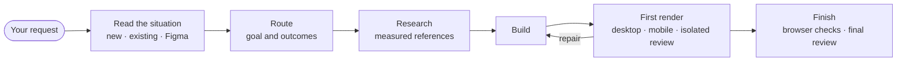

<p align="center">
  <picture>
    <source media="(prefers-color-scheme: dark)" srcset="brand/readme/header-dark.svg">
    
  </picture>
</p>

<h3 align="center">AI that designs like a human.</h3>

<p align="center">
An open-source design harness for coding agents. Before it draws anything, OMD asks who the page is for,<br>
finds and measures real references, builds once, and compares its render blind against human-made pages to catch AI slop.
</p>

<p align="center">
  <a href="https://www.npmjs.com/package/@3xhaust/oh-my-design"></a>
  <a href="https://www.npmjs.com/package/@3xhaust/oh-my-design"></a>
  <a href="https://github.com/3x-haust/oh-my-design/actions/workflows/ci.yml"></a>
  <a href="https://github.com/3x-haust/oh-my-design/stargazers"></a>
  <a href="LICENSE"></a>
</p>

<p align="center">
  <b>Claude Code</b> · <b>Codex</b> · <b>Pi</b>
  &nbsp;—&nbsp;
  <a href="#quick-start">Quick start</a> · <a href="#how-it-works">How it works</a> · <a href="https://3x-haust.github.io/oh-my-design/">Landing page</a> · <a href="README.ko.md">한국어</a>
</p>

https://github.com/user-attachments/assets/07910831-4b34-4015-bfd8-f4a2216d9088

<p align="center"><sub>The OMD launch film (39 s, with sound): a one-shot AI page goes in, the same page comes back redesigned one decision at a time.</sub></p>

## Same request. Different process.

<p align="center"></p>

The same bakery booking request. On the left, the page a model draws in one shot; on the right, the page OMD designed.
Under each is the real `omd check` output for that page: the left trips the slop rules (two equal primary buttons,
three identical cards, gradient text), the right returns no findings. The pages are the illustrative examples from
our launch film. Slop findings are a quality floor, not proof of authorship.

## Quick start

```bash
npm install -g @3xhaust/oh-my-design
oh-my-design install    # adds the skill and reviewer agent to every detected host
omd doctor              # checks the runtime, Chromium, write access and the theory pack
```

Then ask your agent for a design:

| Host | Try |
| --- | --- |
| Claude Code | `/ultradesign a booking page for a neighbourhood bakery` |
| Codex | `$omd-ultradesign a booking page for a neighbourhood bakery` |
| Pi | `pi install npm:@3xhaust/oh-my-design`, then `/ultradesign a booking page for a neighbourhood bakery` (`/omd` checks the project) |

Needs Node.js 22.19+. Every install option, the Claude Code marketplace and the browser provider are under [Install](#install).

## Four habits a one-shot prompt skips

| Asks first | Measures, not mood boards | Reviewed blind | Checks its own work |
| --- | --- | --- | --- |
| Records the goal, the required and prohibited outcomes, and the task contract before any layout. | Collects measured references — type, density, composition — and transfers principles, never pixels. | An isolated reviewer that did not build the page judges its captures without the builder's rationale. | Renders desktop and mobile with `omd first-render check`, repairs what the review finds, and finishes through `omd lifecycle finish`. |

## How it works



The route is adaptive, not a mandatory checklist: the model chooses the methods the request needs, and a method it
does not use needs no written skip. The full loop is under [The human design loop](#the-human-design-loop).

## Skill

One user-facing skill, `omd-ultradesign`, is the only entry point. Codex shows it as `(omd) ultradesign`, and the Claude marketplace flavor references it as `oh-my-design:ultradesign`. It reads the project and the full request itself and never asks which mode to use.

| Situation | What `omd-ultradesign` does |
| --- | --- |
| No product source yet | Builds the complete requested product from scratch, inspecting strong references before choosing a direction. |
| Existing project | Reads the stack, routes, components, tokens and current renders first. A new feature extends the existing system; a redesign captures the current desktop and mobile screens as a baseline and keeps every function, route and data contract; a fix stays local. |
| Figma link in the request | Treats the frames as the target, then repeats `omd figma diff` and `omd figma review` until the isolated reviewer returns `match`. |
| Images or URLs you supply | Keeps the role you gave them: delivery target, inspiration, domain evidence, or a rejected result that serves only as a comparison baseline. |

Reference, Figma, copy, critique, audit and coaching guidance ships as internal guides that the skill opens only when they apply (`omd pack guides/<name>.md`).

## Built with OMD — in one shot

The landing page was generated by OMD itself from a single one-shot prompt — the visual output was not hand-tuned. View it at **[3x-haust.github.io/oh-my-design](https://3x-haust.github.io/oh-my-design/)**.

## Documentation

<details>
<summary><b>What “design like a human” means</b></summary>

### What it is

**AI that designs like a human.** Give OMD one request. It researches, compares real material, chooses a direction, builds, renders, and repairs internally. The model adapts its methods to observed evidence rather than requiring routine reference or draft approval; account access and external-action permissions remain separate.
Native Pi uses the same production engine for normal autonomous execution and explicitly enabled private developer evaluation. See [usage, private evaluation and versioned calibration](core/protocol/autonomous-design.md). Technical integration is tested; human-level quality claims still require real held-out blind ratings.

Here, “design like a human” means accountable judgment, not a signature look. The goal is a repeatable process; the result can be quiet, expressive, conventional, or strange. What stays constant is the chain of decisions behind it.

The [design practice contract](core/protocol/design-practice.md) makes this concrete inside each
selected method. Behavioral checks remain distinct from claims about human-level quality.
Local research and development notes under `/docs/` are not tracked or published with the repository.

Concept exploration follows the content: a page can revolve around one strong idea, and alternatives
can share a brand palette. Visual drafts help choose a direction even when the delivered page is
entirely HTML and CSS. OMD compares feasible directions for their visible design and task fit;
passing a build or fidelity check alone does not establish visual quality.

Oh My Design (OMD) keeps a coding agent from jumping straight from a request to polished UI. It asks what problem is being solved, records evidence, compares real references, and has an isolated reviewer critique the rendered output without exposing it to the builder’s rationale.

The durable loop is adaptive rather than a mandatory stage checklist:

```text
original request → route (outcome, scope, evidence) → references and model-chosen methods
                 → production build → first render: isolated desktop/mobile review → repair
                 → lifecycle finish: package checks, real browser captures, independent review
```

Product work and marketing work are researched differently: product UI is compared with populated
task screens of real services, a landing or launch page with finished service websites. OMD
preserves the user's model choice in both cases, and it does not invent a product capability merely
to make an under-specified greenfield concept look distinctive.

OMD runs inside **Codex**, **Claude Code**, and hosts that implement the public **Pi extension API**. It ships one user-facing skill (`omd-ultradesign`), one read-only reviewer agent (`omd-eye`), a local `omd` CLI, design theory and recipe packs, and a durable project record under `.omd/`.

</details>

<details>
<summary><b>Requirements</b></summary>

### Requirements

- **Node.js 22.19 or newer** (the CLI runs the TypeScript entrypoints directly)
- **Claude Code, Codex, or a Pi-compatible host**
- A browser provider: **browser-rs v0.1.10** is preferred on its two supported platforms; **Playwright + Chromium** remains the required fallback for rendering, probing, and typography proofs (see below)

</details>

<details>
<summary><b>Install — every option, Pi, browser provider, reference research</b></summary>

### Install

#### npm — global CLI (recommended)

```bash
npm install -g @3xhaust/oh-my-design
oh-my-design install    # install the plugin into every detected host and patch its config
oh-my-design doctor     # verify the host install
omd doctor              # verify the runtime, Chromium, project write access, and the theory pack
```

`oh-my-design install --host claude|codex` scopes install, doctor, and uninstall to one host. `uninstall` reverses exactly what `install` did and never touches your `.omd/` directory. Host installation also attempts browser-rs afterward and reports `present`, `installed`, `unsupported`, or `failed`; a browser-rs failure does not roll back an otherwise healthy OMD/Playwright host installation.

> Install the **scoped** package `@3xhaust/oh-my-design`. The unscoped `oh-my-design` on npm is an unrelated project.

#### Pi-compatible hosts — extension package

OMD is a standard Pi package. Pi and API-compatible forks such as Senpi load the same extension
and canonical skill; OMD does not probe or launch a Senpi executable.

```bash
pi install npm:@3xhaust/oh-my-design
```

For a compatible fork, use that host's package-install command with the same npm package. The
extension registers `/omd` for a project doctor check and the structured `omd_cli` tool for the
existing OMD CLI. `/ultradesign <request>` is an alias for `/skill:omd-ultradesign <request>`.
Compatibility requires the public Pi extension/package API; fork-only APIs are not used.

Pi's `omd_cli` does not need an external activation file. First run
`omd route validate --input .omd/.cache/route-input.json --json`, repair the named input errors,
then publish with `route classify`. An input validation error is not missing host authentication.

[Three-layer enforcement](core/protocol/three-layer-enforcement.md) connects **declaration → procedure → automatic refusal**.
After `route classify`, `omd stage next --json` reports the current model-led action. `omd guard production --json`
must pass before source work, and a failed guard does not mutate application source. `omd guard completion --json`
reports any blocker that withholds a success claim.
Pi's public `tool_call` / `message_end` hooks ensure native `write`/`edit` application mutations
and arbitrary `bash` wait for current pre-production inputs; research inputs and directly owned
design documents remain writable. The completion hook withholds an unverified final success claim.
OMD commands are queued per project to prevent sibling calls from competing for the mutation lock.
During a source-writing turn, repairable terminal failures keep triggering repair/recheck follow-ups
while the named work pointer or authored evidence changes. Two consecutive unchanged failure states
stop the loop; authority failures and user aborts do not retry. Message replacement semantics are verified against Pi
0.85.1; forks must support that public event behavior, not merely expose an `on` function.
An explicit full-build request with the packaged skill also continues a checked selected stage on
an existing route after a failed publisher; research-only or stop-at-stage requests do not.
Run `/omd` after `/reload`; hook-less compatible hosts explicitly report that only CLI checks exist.
Hooks are workflow gates, not an OS sandbox or proof of design quality. External processes/custom
mutation tools are outside this hook boundary, and streamed draft text may precede final validation.
Independent reviewer authorization is still required by implementation final evidence; Pi does not
manufacture it. After upgrading, revalidate/reclassify the original approved route with the current
build if old build/skill authority is stale.

Reference research is saved separately: `.omd/refs/domain/research.json` for similar-service screens,
features and flows, and `.omd/refs/design/research.json` for composition, type, density and component
craft. `omd ref discover-plan --json` suggests screen galleries such as Mobbin/Page Flows/UI Bowl/Pinterest for product
UI and website galleries such as Siteinspire/Pinterest for marketing. Verify free access per entry;
on blocked/login/paid access, use another public source without purchases, trials or MCP installation.
Free viewing does not grant reuse rights. Record the inspected screen, discovery entry and concrete
quality reason, not just a prestigious gallery name. Visit gallery items with `omd ref navigate
<item-url> --lane design --json`; their captures stay under `.omd/discovery/design/`. Retain the
observed original or capture the loaded UI image with `ref add <item-url> --lane design
--selector `, not the wrapper chrome; cropping is optional. Use `omd schema reference-research --json`,
`omd ref research-set --input <input.json>` and `omd ref research-check --json` to publish/check both
files and their aggregate consistency receipt. Capture PNGs and metadata directly into their own
folders with `ref add --lane domain|design` or `lane` on each add-batch entry. Inspect them with
`ref list --lane domain|design --json`; domain captures do not silently enter the visual board.
Current v7 research binds source and gallery-entry PNGs to native capture JSON, keeps domain and
design lanes separate, and records source-specific market coverage when a market is explicit or a
Korean-language user brief starts Korean-first reference research. That default never dictates a
country aesthetic. Korean welfare discovery now starts with actual service-name searches on the
public Daum web endpoint; Korean-language `.com` products can qualify, while English foreign
government domain captures are refused until current local-domain research validates the local
coverage and any global fallback. Locally authored capture files or `--from-user` alone do not
unlock that fallback. Selector-scoped captures check the full page's visible-language balance.
A homepage is not an inspected
entry, and a different original source must appear in the gallery's observed outbound links.
Historical v5 remains readable with search-only requirements; v6 retains its search-or-direct-root
contract. Reuse valid captured evidence only when current validators permit, then publish through v7
without relabelling historical bytes.
Domain/design hosts, final redirects and PNG evidence must be independent. Non-user discovery must
be a supported public gallery item, not a service page labelled as a gallery. Public Pinterest,
Dribbble and Behance items do not require UI Bowl's paid MCP. Free viewing is checked per item.
Design sources declare visual-direction or component-support with observed composition, type,
density, imagery, transfer and exclusions. Current v7 needs at least two independent visual-direction
service families from distinct inspected gallery items with different PNG bytes, and both directions
must participate in the current board. Tracking URL variants, renamed captures, and unused screenshots
do not count. Every board candidate uses visual-direction evidence; support-only documentation cannot
complete the lane. Inspect previews in `.omd/refs/design/README.md`.
These are provenance/role checks, not a machine certification of beauty.

Current v7 requires native acquisition evidence, not query prose. `omd ref search --input <json>` accepts
`{lane, query, url, queryParam}` and records a fresh-browser GET, actual links/capture or failure.
Put its returned receipt in the lane's `searches`. Every query must match an execution and retained
non-user sources/entries must occur in observed links and have separate native visit captures.
Failed attempts can accompany a usable free alternative. HTTP 200 alone is not search quality.
The executor accepts public Google/Bing/DuckDuckGo search pages with `queryParam: "q"`; use task/pattern
and gallery `site:` queries. Arbitrary service pages with invented query parameters are rejected.
When search is blocked, v6/v7 also allow signed direct-public list discovery through `omd ref navigate`.
New search-v2 and direct-entry-v3 records are project-signed and tamper-evident, but they are not
provider-attested truth and do not certify quality, market fit or authority.
For explicit-market local coverage, a signed search result's visible link text must name the market
and relevant service/product scope. A localized query by itself does not make a source local.
Both that provenance and the retained source observation must be no more than seven days old.
Direct-public local coverage applies the same rule to the selected link's visible label; a market
heading elsewhere on the directory cannot qualify an unrelated service. Every declared attempt and
chosen retained capture is time-limited. Each global fallback source also binds to the exact signed
search/direct receipt whose visible label reached it.

Similarity discovery may keep intermediate native captures in each lane's optional `navigation`
array (`url`, PNG `evidence`, JSON `capture`). Only observed links rooted in a successful search
extend the chain. `omd first-render check --page <local-build.html>` captures the local production
build, not a preview URL; agent-authored surface input is refused. Advisories do not block
completion by themselves.

#### Claude Code — plugin marketplace

```text
/plugin marketplace add 3x-haust/oh-my-design
/plugin install oh-my-design@omd
```

Then open a session and run `/ultradesign`.

#### From source (contributors)

```bash
git clone https://github.com/3x-haust/oh-my-design
cd oh-my-design
npm install
node bin/omd-install.ts install    # install the plugin into detected hosts
node bin/omd.ts doctor

# Test the source extension in Pi without installing it globally.
pi -e ./extensions/omd.ts
```

#### Browser provider and Chromium (after global installation)

After globally installing `@3xhaust/oh-my-design`, OMD prefers the `browser-rs` MCP provider for interactive reference research, user-directed region captures, and visual QA. It is a deliberately narrow v0.1.10 integration, not a claim of universal browser compatibility:

| Platform | browser-rs state | Exact SHA-256 |
| --- | --- | --- |
| Darwin arm64 | Supported; default interactive provider when healthy | `9a5895fc2f07b1010226d30f081d678fa2edcc15dd6f24cdf10074cfe1573749` |
| Linux x64 | Supported; default interactive provider when healthy | `792ca76e5ce0423968763556e110900a3aa65737fc6227724914aa137e972589` |
| Any other platform | Unsupported; no browser-rs download | Use the Playwright + Chromium fallback below. |

The managed binary, when installed, is `$HOME/.local/share/oh-my-design/browser-rs/v0.1.10/browser-rs` with a verified `receipt.json`. OMD verifies the exact checksum before publishing it. Resolution is `OMD_BROWSER_RS_BIN`, then `browser-rs` on `PATH`, then that receipt-owned target. OMD never overwrites a foreign override/PATH binary or an unreceipted/tampered managed-target file, and `oh-my-design browser uninstall` removes only matching OMD-owned receipt-and-digest bytes.

```bash
# Explicit provider lifecycle. `doctor` exits 1 when the selected provider is not healthy.
oh-my-design browser install
oh-my-design browser doctor --json

# After global package installation, provide your own equivalent local HTML fixture.
oh-my-design browser smoke --fixture /absolute/path/to/local-probe.html --out /tmp/omd-browser-rs-smoke.png

# Preserves foreign, unreceipted, or tampered bytes rather than deleting them.
oh-my-design browser uninstall
```

From a source checkout, use the proven TypeScript entrypoint instead of assuming a global bin:

```bash
node bin/omd-install.ts browser install
node bin/omd-install.ts browser doctor --json
node bin/omd-install.ts browser smoke --fixture test/fixtures/probe.html --out /tmp/omd-browser-rs-smoke.png
node bin/omd-install.ts browser uninstall
```

On a supported platform, missing, unowned, or bad browser-rs is unhealthy; first repair the intended binary/ownership (or intentionally set `OMD_BROWSER_RS_BIN`), then rerun `browser doctor`. On an unsupported platform, provider health is good only when the Playwright module and Chromium fallback are both available. Existing `omd render` and `omd probe` are the deterministic Playwright fallback after browser-rs initialization or capability failure.

The installer does not install Chromium. If `omd doctor` reports Playwright unavailable or its Chromium executable missing, install what the report names, then re-check:

```bash
npm install -g playwright
npx playwright install chromium
node bin/omd.ts doctor
```

</details>

<details>
<summary><b>Reference capture</b></summary>

### Reference capture

OMD treats a reference as evidence for a specific decision, not as a whole-site style to copy. On the default route the model researches through `omd ref browse` sessions — real services in the same category and market in the domain lane, design, graphic and whole-site galleries in the design lane — keeps whole originals with a reason, and records the originals it actually compared through `omd ref context`: exactly one primary and any supplemental originals, each named for the destination component it informed. That record is comparison context, not approval; the early and final reviewers receive those exact originals privately and compare them with the real render.

```bash
# Internal agent operations.
omd ref browse start --lane design --json
omd ref browse search dribbble "<words from this brief>" --session <id> --json
omd ref browse keep --role component-support --reason "..." --session <id>
omd ref add <url-or-local-page> --as <component> --lane design --selector '<css>' --blueprint --shot
omd ref add <url> --as <component> --lane design --preparation <state.json> --no-energy
omd ref import-image ./local-fragment-input.json
omd ref context --input consulted-references.json --json
```

#### Captures and traceability

Short standalone component examples need not be mistaken for empty pages: OMD checks the requested HTML element's rendered size, visibility styles, and text. This is not a visual-quality verdict. HTTP 403, server errors, and challenge pages remain rejected.

Desktop and mobile views of the same component stay together without inflating reference diversity. State-preserving capture can observe existing focus or an explicitly opened disclosure; unmeasured interaction and motion remain unknown. See the [capture protocol](core/protocol/reference-assembly.md#capturing-an-existing-state-or-open-disclosure).

Motion reference capture can observe a loaded component while background requests remain open. Its returned measurements still need visual inspection; they are not a design-quality or accessibility certificate.

A component brick is a selector-scoped blueprint plus a local PNG. For Pinterest-like galleries and similar sources, browser-rs performs the **user-directed** region capture and `omd ref import-image` imports that local PNG. The input records absolute HTTP(S) `sourcePage`, optional `sourceImage`, human-readable `captureRegion`, optional `cropBox`, `licenseStatus` (`allowed`, `restricted`, or `unknown`), rights notes, visual role/principles, and canonical provenance time. OMD does not scrape, hotlink, download remote source images, or ship their pixels.

Production takes what designers take from a reference — padding, spacing rhythm, hierarchy and control anatomy — and leaves its colour, branding and copy behind. Research images remain comparison evidence, never shipped product assets. The final answer presents the consulted originals and their source URLs beside the generated desktop and mobile screens, with the transferred structure and its limits.

See the [reference assembly protocol](core/protocol/reference-assembly.md) for capture, evidence, source-isolation, and transfer contracts.

</details>

<details>
<summary><b>Designed around your material</b></summary>

### Designed around your material

Ordinary `/ultradesign` use needs no style vocabulary. When real first-party content has a stable
shape, OMD may adapt composition to its lengths, counts, aspect ratios, or semantic outliers. The
result includes a read-only Fit Receipt showing what stayed intact and where the desktop and mobile
evidence lives. OMD stores hashes, project-relative paths, and bounded measurements, not raw content,
and it never infers taste from silence.

</details>

<details>
<summary><b>Designed for the language and market you actually mean</b></summary>

### Designed for the language and market you actually mean

OMD does not treat localization as sentence translation, and it does not map a language code to a
country theme. It keeps the conversation language separate from the surface locale, explicit market,
audience and task, domain, surface type, and brand invariants. `ja-JP` can establish Japanese script
mechanics; it cannot by itself authorize a Japanese market aesthetic. Bare `zh` does not silently
become mainland China, and `zh-CN` and `zh-TW` remain separate contexts.

A Korean-language brief with no other market named may default reference discovery to Korean
services. That is a research default only; it does not establish a Korean aesthetic or cultural fit.

For ordinary `/ultradesign` use, state the surface language and intended market/audience. If market
or audience authority is missing, OMD asks one focused question and stops that research route if it
remains unresolved. The locale context's `marketAuthorityClaimId` must name a confirmed
`evidenceClaims.userFacts` claim whose user evidence actually names that market. A mechanics-only route checks real target-language copy and type mechanics but
makes no cultural-fit claim. A market-grounded route collects current
standards, a global equivalent or exact unavailability, native first-party category evidence, and a
counterexample for the named decisions. It preserves only `supported`/`shared` mechanisms, routes conflict
as `contested`, and turns missing evidence into `unknown` rather than a visual rule.
The comparison lanes must serve the same named task or category; a generic homepage from the same
institution is not an equivalent. Recorded unavailability limits confidence and never votes for
convergence.

Expert/debugging surface. This is not a standalone quickstart: run only the commands selected by the
current route. `--activation` takes a host-issued invocation file (`OMD_ACTIVATION_PATH` when the host
supplies one); `omd schema` prints the input skeleton, and source capture repeats once for each declared
evidence source.

```sh
omd schema locale-design-context
omd locale plan --input .omd/locale-design-context.json --json
omd route classify --input .omd/.cache/route-input.json \
  --locale-context .omd/locale-design-context.json \
  --activation "$OMD_ACTIVATION_PATH"
omd locale source-capture --url https://example.org/current-source \
  --activation "$OMD_ACTIVATION_PATH" --json
omd locale profile --publish --input cultural-profile.json \
  --activation "$OMD_ACTIVATION_PATH" --json
omd locale profile-check --activation "$OMD_ACTIVATION_PATH" --json
```

The profile and sanitized projection are content-addressed and bound to current source bytes,
target-language type proof, route context, and brand invariants. Production work receives the
source-free projection, never source URLs or a country-style prompt. Agent review can report
evidence-grounded adaptation only. OMD does not claim that a result is culturally native or preferred
without genuine blind ratings from the named target audience, collected independently from actual members.

</details>

<details>
<summary><b>The human design loop</b></summary>

### The human design loop

`omd-ultradesign` runs the loop below on the default model-led route. The model chooses methods,
candidate count and delegation; there is no mandatory role relay, candidate competition, written
skip or intermediate design document for a method it does not use.

1. **Read the situation** — inspect the actual project and the full request: no product source yet, an existing project, a Figma link, or images and URLs you supplied. A Figma link makes its frames the target and brings in the internal Figma guide (`omd pack guides/figma.md`).
2. **Route** — write `route-input` for existing or bounded work, or `product-route-input` for a new product, then `omd route validate` and `omd route classify`. `omd stage next --json` reports the current action.
3. **State the task contract** — audience and expertise, task frequency, input modes, density, locale and representative content, before styling.
4. **Research** — `omd ref browse` sessions search the domain lane (real services in the same category and market) and the design lane (design, graphic and whole-site galleries) in the brief's own words, component by component, including hover, focus, pressed and open states. The originals actually compared are recorded with `omd ref context`, with exactly one primary.
5. **Words, type and flow** — labels state the true commitment, errors explain recovery beside the field, applicable loading, empty, error, success and disabled states are designed, and type roles are built up from body text using only fonts with unrestricted licences.
6. **Build** — `omd guard production --json` passes before source work. One complete representative composition with realistic content and states is built and inspected as a whole render before the system is extended.
7. **First render** — `omd first-render check --page <built file> --json` captures desktop (1280×900) and mobile (390×844) and launches the isolated early reviewer, which answers the designer judgments and compares the render with the primary original. Localized findings are repaired; after a regression `omd first-render restore` returns to the best iteration, and a stalled loop stops and reports the remaining findings.
8. **Compare with human work** — `omd taste compare --json` runs blind A/B trials against captured human-made pages. The comparison itself is advisory and never blocks completion; the final judged-AI rate is reported honestly. On a new landing page, though, skipping section graphics or finishing with no observable motion is accepted only after this comparison finds the page indistinguishable from human-made work.
9. **Finish** — one `trusted-lifecycle-manifest` is authored from the real controls. `omd lifecycle finish --json` runs package checks, real browser evaluation at desktop and mobile, source sealing, isolated visual, fidelity and outcome review, and final publication. `omd guard completion --json` withholds a success claim while a blocker remains.

A linked Figma target is proven by its own frame diffs and reviews instead of a consulted primary original.

</details>

<details>
<summary><b>Reviewer agent</b></summary>

### Reviewer agent

One internal agent, `omd-eye`, is an implementation detail of the loop, not a public command. It did not build the work: the host gives it one mode-bound packet — task constraints, evidence, fixed bindings and a closed output contract — and it returns only that contract, never source edits. It never mints signatures, capture hashes or human approval; its judgments are packet-bound model decisions, not user choices.

The agent does not pin a concrete model. It uses the model selected for the host session, and its source declares only an effort tier (`high`): Claude Code receives `model: inherit` plus that effort, and Codex receives `model_reasoning_effort` with no model.

| Agent | Responsibility | Write boundary |
| --- | --- | --- |
| `omd-eye` | Reviews one mode-bound packet: production visual review of anonymous captures, fidelity against the chosen system or reference, or protocol review of native receipts. | No writes. |

Claude Code can enforce declared denied tools in agent metadata. Codex agent files have no equivalent tool-restriction field, so read-only limits there are prompt contracts rather than a hard sandbox. OMD does not describe those contracts as filesystem isolation.

</details>

<details>
<summary><b>Evidence boundaries and artifacts</b></summary>

### Evidence boundaries and artifacts

| Stage | Durable output | Boundary |
| --- | --- | --- |
| Route | `.omd/route.json` | Classified from the validated `route-input` or `product-route-input`. Preserves the exact request, scope, allowed paths and evidence claims; production writes stay inside the allowed paths. |
| Research | `.omd/refs/`, `.omd/discovery/` | Builders receive transferable structure, not screenshots to imitate. Failed URLs and challenge pages are acquisition failures, not evaluated alternatives. |
| Consulted references | `.omd/consulted-references.json` | Exactly one primary whole original with its digest, source URL, destination component and optional state. Required for model-led visual work except copy-only work or a Figma target. Comparison context, not approval. |
| First render | `.omd/first-render/` | Desktop and mobile captures, reports, reviews and checkpoints for each iteration. The early review is a model judgment, neither source-fidelity proof nor human approval. |
| Qualitative feedback | `.omd/qualitative-feedback.json` | `omd feedback report` keeps your verbatim opinion and the exact images you were shown separate from the model's interpretation. Comparison-only, not approval. |
| Taste comparison | `.omd/taste/` | Blind A/B results against captured human-made pages and graphic comparisons. Advisory. |
| Figma | `.omd/figma/` | Snapshot, diffs, renders and exports for a linked Figma target. |
| Final source seal | `.omd/source-seal.json` | Written by `omd lifecycle finish`; proves byte freshness of production source, not semantic fidelity. |
| Final review | `.omd/final-review/` | Independent visual, fidelity and outcome review over real browser captures. Independent model review is not human aesthetic approval. |

The normal user supplies the request, not a sequence of design approvals.

</details>

<details>
<summary><b>Stack routing</b></summary>

### Stack routing

Every build follows the same precedence:

```text
explicit user request
  > existing repository stack and toolchain
  > React + Vite + strict TypeScript for any new web project, landings included
```

Existing vanilla HTML is an existing stack. An unrecognized package or toolchain is investigated and preserved, not treated as an empty repository. A bare `index.html`/`.css`/`.js` with no manifest next to an `.omd/` from a prior OMD run is OMD's own leftover output, not a user stack. Browser TypeScript is compiled to JavaScript; uncompiled TypeScript is not shipped. New projects are written for review: one component per section or reusable part, real `dev`/`build`/`typecheck`/`test` scripts, and formatted source. `omd lifecycle finish` refuses hand-authored source packed onto long lines. Existing projects should not receive unnecessary dependencies.

</details>

<details>
<summary><b>Verification stack</b></summary>

### Verification stack

OMD combines deterministic checks with rendered review.

| Layer | Commands and evidence |
| --- | --- |
| Route and guards | `omd route validate` and `route classify` check the route input. `omd guard production --json` gates source work; `omd guard completion --json` reports completion blockers. |
| Render evidence | `omd render` captures the exact viewport by default; `--full-page` is supplementary continuity evidence, `--squint` isolates hierarchy with grayscale and blur, `--filmstrip` captures load-time frames, `--motion` records a load and scroll timeline with a contact sheet, and `--graphic` renders a graphic built in code to a 2x image. `omd record` captures product footage from declared steps. |
| First render | `omd first-render check --page <local-build.html> --json` measures the desktop and mobile captures and runs the isolated early review; `first-render review` re-runs that review and `first-render restore` returns to the best recorded iteration. |
| Measurement | `omd measure --entry <local.html|URL> --json` records native visual measurements of a local build or URL. |
| Interaction | `omd probe` executes only a declared, safe local plan and reports expectation or tab-order failures. |
| Source candidates | `omd slop scan [root] [--json]` reads supported production source without writing it. Candidates require contextual triage; they are not `omd check` warnings, scores, or authorship claims. |
| Design lint | `omd check` evaluates `system`, `a11y`, `slop`, `motion`, and `ux` conditions. Contrast and hit-area rules are errors; slop and other quality-floor rules are warnings where authored that way. Any finding exits 1, so it is usable in CI. |
| Site consistency | `omd check --site <dir>` or multi-page positional checks report cross-page ladder and token drift. |
| Human comparison | `omd taste compare --json` runs advisory blind A/B trials against captured human-made pages. `omd taste graphic <png> --against <kept image>` judges a section graphic blind beside a kept reference. |
| Figma fidelity | `omd figma pull`, `system`, `diff`, and `review` connect a Figma snapshot to the implementation; `review` returns the isolated reviewer's concrete region fixes until `match`. Requires `export FIGMA_TOKEN=…`; `omd doctor` treats a missing token as optional. |
| Visual target | `omd target set <image-path-or-url> --as <name>` and `omd target diff` run a bounded image comparison against a registered PNG target. A URL must be a direct HTTP(S) image URL. |
| Performance | `omd lighthouse <lighthouse-report.json>` gates a Lighthouse JSON report against a performance budget (default: performance ≥ 90 and Core Web Vitals within Google's "good" thresholds). You run Lighthouse (`npx lighthouse <url> --output=json`); OMD gates its report and exits non-zero on a breach. |
| Completion | `omd lifecycle verify install|ci|build|typecheck|test|lint` runs one package check; `omd lifecycle finish` runs package checks, real browser evaluation, isolated review and final publication together. |

Slop findings are a quality floor and warnings; they do not prove a design was generated by AI. A written overrule records intent but does not suppress a finding or change command status. Rendered critique remains necessary — a rule engine cannot safely judge optical balance, composition rhythm, typography craft, or whether the memorable moment belongs to the concept.

</details>

<details>
<summary><b>Interaction applicability</b></summary>

### Interaction applicability

The trusted lifecycle manifest (`omd schema trusted-lifecycle-manifest`) carries one browser script per current task outcome. Each script performs real actions and asserts what a visitor would then see.

| Assertion | Use it for |
| --- | --- |
| `visible-text` | Text that appears because of the actions; it fails when the text was already visible before them. |
| `preserved-text` | Text that must stay visible through the actions. |
| `absent-text` | Text that must not be visible, such as an invented claim the outcome forbids. |
| `element-state` | `hovered`, `focused`, `focus-visible`, `pressed`, or `expanded` on the exact element that receives it; a `captureState` needs one. |

Loading, empty, error, success, disabled, offline, and recovery states are designed only when the surface can reach them — the harness does not add fake states to satisfy a checklist. `omd probe` plans (`.omd/probes/primary.json` by default) use declared click, fill, and keypress steps with explicit expectations, are limited to local files and localhost/loopback URLs, and reject authenticated, remote, destructive, or undeclared actions. OMD never discovers controls and clicks them automatically.

</details>

<details>
<summary><b>Project state</b></summary>

### Project state

Durable, reviewable records live directly under `.omd/`:

- `route.json`, `consulted-references.json`, `qualitative-feedback.json`, `locale-design-context.json`, `source-seal.json`
- `refs/`, `discovery/`, `first-render/`, `final-review/`, `taste/`, `figma/`
- declared `probes/*.json` and `history.jsonl`

Route inputs, the trusted lifecycle manifest, and other scratch output live under `.omd/.cache/`; deleting the cache should not erase design intent. `oh-my-design uninstall` removes installed OMD files and config changes while preserving the project’s `.omd/` directory.

</details>

<details>
<summary><b>CLI reference</b></summary>

### CLI reference

A compact map of `omd help`:

```text
omd route starter|validate|classify|show|check
omd schema list  |  omd schema <name>  |  omd schema ai-judgment --purpose <purpose>
omd stage next [--json]
omd guard production|completion [--json]
omd lifecycle verify install|ci|build|typecheck|test|lint [--project <dir>] [--json]
omd lifecycle finish [--project <dir>] [--manifest <json>] [--json]

omd ref browse|tidy|context|navigate|control-observe|cookie-control
omd ref discover-plan|discover-batch|work-next|advance|exclude|direction-review
omd ref research-set|research-check|search|leads
omd ref add <url|file> --as <component> [--lane domain|design] [--selector "css"] [--image] [--blueprint] [--shot]
omd ref add-batch|list|show|principles|audit|import-image
omd feedback report|translate|check
omd language translate|check
omd ai-judgment publish|check
omd locale plan|profile|profile-check|source-capture|source-stability|check

omd first-render check --page <local-build.html> [--json]  |  omd first-render review|restore [--json]
omd render <page|url> [--viewport WxH] [--out file.png] [--full-page] [--squint]
omd render <page|url> --graphic | --motion | --proofs | --filmstrip
omd record <page> --steps <steps.json> [--viewport WxH] [--out dir]
omd check [<page>|--ir file] [--json] [--category slop] [--no-log]
omd check --site <dir>  |  omd check <page1> <page2> ...
omd probe <page> [--plan path] [--viewport WxH] [--json] [--out path]
omd slop scan [root] [--json]  |  omd slop score --input <invariants.json> --corpus <corpus.json> [--json]
omd lighthouse <report.json> [options]
omd measure --entry <local.html|URL> [--scope <scope.json>] [--json]

omd figma pull <file-url>  |  omd figma system  |  omd figma diff <frame-id> <page-or-url> [--json]  |  omd figma review <frame-id> [--json]
omd target set <image-path-or-url> --as <name>  |  omd target list  |  omd target diff <page> [--target <name>] [--viewport WxH] [--threshold N] [--json]
omd taste compare [--anchor <url>] [--json]  |  omd taste graphic <rendered.png> --against <image.path> [--json]

omd pack dir | list | <relpath> [--section <heading>]
omd doctor
omd browser setup|login|skip|status|forget
omd coach
omd learn predict|judge|observe|promote|rules
omd usage [--json]
omd hash <.omd/artifact-path> [--json]
```

</details>

<details>
<summary><b>Architecture</b></summary>

### Architecture

Prompt source of truth:

- `src/agents/*.agent.yaml`
- `src/skills/omd-*/SKILL.md`

Generated outputs — **do not edit directly**; `npm run build` regenerates them for direct hosts and plugin packaging:

- `agents/`, `skills/`, `dist/`

Edited directly: `core/`, `bin/`, `adapters/`, `test/`, `evals/`, `scripts/`, `README.md`, `README.ko.md`, and the theory and recipe packs under `core/`.

</details>

<details>
<summary><b>Testing</b></summary>

### Testing

Tests are classified as unit, integration, browser, native, or packaging. `npm test` builds stale generated output when needed and runs every tier with safe concurrency; use `npm run test:unit` or another `test:<tier>` command for focused work. Coverage uses the deterministic unit and integration tiers.

```bash
npm test
npm run test:coverage
npm run typecheck
npm run build
```

</details>

## FAQ

**Do I need a browser?** Yes, for rendered checks. OMD uses Playwright + Chromium for deterministic rendering and probes; on supported platforms a healthy browser-rs provider is preferred for interactive browser work. Run `omd doctor` if a browser check fails.

**Does it copy reference sites?** No. It records what was observed and what to transfer or avoid; production receives a source-isolated design direction. A public reference is not permission to reuse its pixels. [Reference protocol](core/protocol/reference-assembly.md)

**Will it guarantee a great design?** No. Checks and browser evidence make decisions reviewable, but visual quality still needs contextual human judgment.

**Can I use it on an existing project?** Yes. OMD inspects the current stack and existing design rather than replacing them with a fixed scaffold. [Workflow](core/protocol/human-design-loop.md)

## Contributing

See [CONTRIBUTING.md](CONTRIBUTING.md) for setup, test classification, three-layer enforcement, generated artifacts, and the branch-to-PR workflow. New linter rules must remain narrow, include positive and negative tests, and always use warning severity.

## Limits and trust

- The prompts define a disciplined workflow; they do not guarantee strong design without real project evidence, usable copy, rendered inspection, and project-specific validation.
- Probes are for local, non-authenticated, non-destructive paths — not a general browser automation layer.
- Native measurements, lint, and image diff inform judgment rather than replace it.
- Plugin/marketplace manifests are shipped artifacts; the from-source direct installer is the path covered by install-to-doctor regression tests.

Licensed under the [MIT License](LICENSE).

## Star history

<a href="https://star-history.com/#3x-haust/oh-my-design&Date">
  <picture>
    <source media="(prefers-color-scheme: dark)" srcset="https://api.star-history.com/svg?repos=3x-haust/oh-my-design&type=Date&theme=dark">
    
  </picture>
</a>
